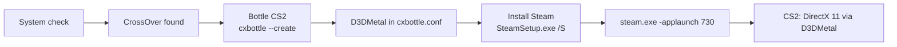

# CS2 Launcher

**English** | [Русский](README.md)

CS2 Launcher is a macOS (SwiftUI) app that helps Apple Silicon Macs run the Windows version of Counter-Strike 2. It runs on top of [CrossOver](https://www.codeweavers.com/crossover): it creates a CrossOver bottle, enables D3DMetal in it, silently installs the Windows Steam client and launches CS2 via `steam.exe -applaunch 730` (DirectX 11 through D3DMetal).

> The app's UI is currently Russian only.

> **Status:** Steam and CS2 (up to the main menu) are verified on an M2 / macOS 26 with CrossOver 26.3.

## Requirements

- Apple Silicon Mac
- macOS 15 or newer
- Rosetta 2 (`softwareupdate --install-rosetta`)
- [CrossOver](https://www.codeweavers.com/crossover) by CodeWeavers: free for 14 days, then a license is required. You install it yourself into Applications; the launcher neither bundles nor downloads it
- Free disk space: CS2 itself takes about 69 GB, ~80 GB recommended (the built-in check only requires 45 GB at setup time, which is not enough to install the game)

## Installation

1. Download the zip from Releases and unzip it.
2. Move `CS2 Launcher.app` to Applications.
3. The app is ad-hoc signed (no developer certificate), so on first launch right-click → Open, or run:

   ```sh
   xattr -dr com.apple.quarantine "/Applications/CS2 Launcher.app"
   ```

## Usage

1. Install CrossOver. If it is missing, the **"Скачать CrossOver"** (Download CrossOver) button on the CrossOver step opens the CodeWeavers site; after installing, press "Проверить снова" (Check again).
2. On the "Настройка" (Setup) screen press **"Установить всё"** (Install everything). The launcher runs the system check, checks for CrossOver, creates the `CS2` bottle with D3DMetal enabled and installs Steam, then opens Steam, skipping steps that are already done. If CrossOver is not found, setup stops with a clear message. On failure the button becomes "Повторить" (Retry) and resumes from the failed step.
3. The first run of a new bottle spends about 3 minutes registering DLLs before the Steam window appears. This is expected.
4. In Steam, sign in yourself and install Counter-Strike 2. The launcher never asks for or stores your credentials.
5. The launcher watches the download itself (`appmanifest_730.acf`): the CS2 step shows "Скачивается: NN%", is marked done automatically when finished, and the app switches to the main screen.
6. Press "Играть" (Play). It works whether Steam is already open or not (it passes `-applaunch 730`). "Стоп" (Stop) kills all processes of the bottle.

### Migrating from an old install

Earlier launcher versions used a standalone Wine and a prefix in `~/Library/Application Support/CS2Launcher/Prefix`. If it exists and the bottle has no Steam yet, the Steam step shows a **"Перенести Steam и CS2 из старой установки"** (Move Steam and CS2 from the old install) button. It clones the Steam folder into the bottle (`cp -Rc`, an APFS clone: instant, no extra disk space) and restores the original `steamwebhelper.exe`. The old folder is left untouched. The migration never runs automatically.

## Settings

App settings window (⌘,):

| Option | Effect |
|---|---|
| Game arguments | Passed to CS2 after `-applaunch 730` (default `-novid`) |
| Steam arguments | Extra `steam.exe` arguments |
| FPS cap | Adds `+fps_max N`; empty means unlimited |
| Metal HUD | `MTL_HUD_ENABLED=1`, shows FPS and GPU load |

`CX_GRAPHICS_BACKEND=d3dmetal` and `WINEMSYNC=1` are written to the bottle's `cxbottle.conf` during setup.

## How it works



The bottle lives in `~/Library/Application Support/CrossOver/Bottles/CS2` and is visible in CrossOver itself. Launcher data is in `~/Library/Application Support/CS2Launcher` (`Logs`, `Downloads`, `settings.json`). The original `steamwebhelper.exe` is left alone and Steam is started without any special flags.

## Troubleshooting

- **No Steam window on first run.** Wait about 3 minutes: CrossOver is registering DLLs in the new bottle.
- **CrossOver not found.** The launcher looks in `/Applications/CrossOver.app` and `~/Applications/CrossOver.app`.
- **Logs.** The log is shown in the app ("Журнал") and also written to a file in `Logs`.
- **Game does not start.** Press "Стоп" and start again; check in the log that the `CS2` bottle exists and D3DMetal is enabled.

## Known limitations

- VAC and matchmaking under Wine are not guaranteed. Use at your own risk.
- Performance depends on your M-series chip.
- CrossOver requires a license after the trial ends.

## Building from source

```sh
swift build
swift test                   # CrossOver is not needed for tests
scripts/make-app.sh          # build/CS2 Launcher.app
scripts/package-release.sh   # zip + sha256 in build/
```

## Credits

- [CodeWeavers CrossOver](https://www.codeweavers.com/crossover) - Windows compatibility layer
- Apple D3DMetal (Game Porting Toolkit) - DirectX on top of Metal

## Disclaimer

Not affiliated with Valve, Apple or CodeWeavers. Counter-Strike and Steam are trademarks of Valve Corporation. CrossOver is a trademark of CodeWeavers. License: [MIT](LICENSE).
