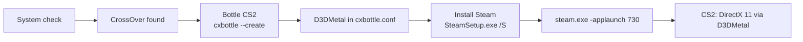

# CS2 Launcher

**English** | [Русский](README.md)

CS2 Launcher is a macOS (SwiftUI) app that helps Apple Silicon Macs run the Windows version of Counter-Strike 2. It runs on top of [CrossOver](https://www.codeweavers.com/crossover): it creates a CrossOver bottle, enables D3DMetal in it, silently installs the Windows Steam client and launches CS2 via `steam.exe -applaunch 730` (DirectX 11 through D3DMetal).

> The app's UI is currently Russian only.

> **Status:** Steam and CS2 (up to the main menu) are verified on an M2 / macOS 26 with CrossOver 26.3.

## Requirements

- Apple Silicon Mac
- macOS 15 or newer
- Internet access (about 370 MB for CrossOver and ~2 MB for Steam). The launcher installs Rosetta 2, CrossOver and Steam itself
- Free disk space: CS2 itself takes about 69 GB, ~80 GB recommended (the built-in check only requires 45 GB at setup time, which is not enough to install the game)

## Installation

1. Download the zip from Releases and unzip it.
2. Move `CS2 Launcher.app` to Applications.
3. The app is ad-hoc signed (no developer certificate), so on first launch right-click → Open, or run:

   ```sh
   xattr -dr com.apple.quarantine "/Applications/CS2 Launcher.app"
   ```

Then: open the app → press "Установить всё" (Install everything) → sign in to Steam → install CS2.

## Usage

Download the app, open it, press **"Установить всё"** (Install everything), sign in to Steam and install CS2. The launcher installs everything else itself, only after you press the button:

- **Rosetta 2**, if missing (`softwareupdate --install-rosetta --agree-to-license`). If it needs administrator rights and fails, the launcher shows "Откройте Терминал и выполните: softwareupdate --install-rosetta" (open Terminal and run it) with a copy button;
- **CrossOver** (trial 26.3.0) from codeweavers.com. The archive is downloaded to `~/Library/Application Support/CS2Launcher/Downloads`, unzipped and verified (`codesign --verify --deep --strict` plus the CodeWeavers signature, Team ID `9C6B7X7Z8E`; on a mismatch the files are deleted and the install is cancelled), then placed in `/Applications`, or in `~/Applications` when that is not writable. An existing CrossOver is never overwritten. CrossOver is paid software: free for 14 days, then a license from codeweavers.com is required. If CrossOver shows its trial dialog on first launch, click "Try Now";
- **the `CS2` bottle with D3DMetal**;
- **Steam** (the Windows client).

1. Open the launcher. An existing CrossOver is used as is; otherwise the CrossOver step installs it for you (the "Сайт CodeWeavers" button opens the download page for a manual install).
2. On the "Настройка" (Setup) screen press **"Установить всё"** (Install everything). The launcher runs the system check, installs Rosetta 2 and CrossOver (if missing), creates the `CS2` bottle with D3DMetal enabled and installs Steam, then opens Steam, skipping steps that are already done. On failure the button becomes "Повторить" (Retry) and resumes from the failed step.
3. The first run of a new bottle spends about 3 minutes registering DLLs before the Steam window appears. This is expected.
4. In Steam, sign in yourself and install Counter-Strike 2. The launcher never asks for or stores your credentials.
5. The launcher watches the download itself (`appmanifest_730.acf`): the CS2 step shows "Скачивается: NN%", is marked done automatically when finished, and the app switches to the main screen.
6. Press "Играть" (Play). It works whether Steam is already open or not (it passes `-applaunch 730`). "Стоп" (Stop) kills all processes of the bottle.

### Migrating from an old install

Earlier launcher versions used a standalone Wine and a prefix in `~/Library/Application Support/CS2Launcher/Prefix`. If it exists and the bottle has no Steam yet, the Steam step shows a **"Перенести Steam и CS2 из старой установки"** (Move Steam and CS2 from the old install) button. It clones the Steam folder into the bottle (`cp -Rc`, an APFS clone: instant, no extra disk space) and restores the original `steamwebhelper.exe`. The old folder is left untouched. The migration never runs automatically.

## Settings

App settings window (⌘,):

| Option | Effect |
|---|---|
| Game arguments | Passed to CS2 after `-applaunch 730` (default `-novid`) |
| Steam arguments | Extra `steam.exe` arguments |
| FPS cap | Adds `+fps_max N`; empty means unlimited |
| Metal HUD | `MTL_HUD_ENABLED=1`, shows FPS and GPU load. Also written to `cxbottle.conf`, so it applies when you press PLAY inside Steam |
| Background apps on E-cores | While the game runs, Chrome, Discord, Telegram and others get background priority (on by default) |
| Performance mode | Disables the Steam overlay for CS2 and the launcher's background checks while the game runs (on by default) |

`CX_GRAPHICS_BACKEND=d3dmetal` is written to the bottle's `cxbottle.conf` during setup. The launcher does not set `WINEMSYNC` (a forced value made the game hang) and removes a line it added earlier.

## Performance

- **Performance mode.** Under Wine the Steam overlay (`gameoverlayui64.exe`) can use more than half a CPU core and cause stutter. Before Steam starts, the launcher sets `OverlayAppEnable = "0"` for CS2 in `userdata/<id>/config/localconfig.vdf` (only while Steam is closed; the original is saved once as `localconfig.vdf.cs2l-backup`). Turning the mode off restores the value, but only where the launcher changed it. While CS2 runs, the launcher checks state at most every 30 seconds.
- **Load distribution.** CS2 uses 2-4 cores, and other apps compete for cores and memory. While the game runs, the launcher runs `taskpolicy -b` on your own Google Chrome, Discord, Telegram, Swiftgram, Spotify, Slack, Microsoft Teams, zoom.us, Yandex, Opera, Firefox and Arc processes, and macOS moves them to the efficiency cores. System processes, Steam, Wine, CrossOver and the launcher itself are never touched. New processes are picked up on the next check; after the game (or when the launcher quits) the priority is restored with `taskpolicy -B`. Can be turned off in Settings.
- **Memory check.** If less than 30% of memory is free or swap exceeds 3 GB, the main screen shows "Мало свободной памяти — закройте тяжёлые приложения, иначе будут фризы" (low memory, close heavy apps or expect stutter) with the five biggest apps. Nothing is closed automatically.
- **No forced MSync.** The launcher does not enable `WINEMSYNC`: with a forced value the game once hung inside ntdll. CrossOver's own default is used.
- **Metal HUD** shows FPS and GPU load. Toggle it in Settings; the change is applied while Steam is closed.
- **The first 1-3 matches** may stutter while D3DMetal builds its shader cache. The launcher reminds you on the main screen for the first three launches. It gets smoother afterwards.
- **Recommended in-game settings:** fullscreen windowed at 1280x832 or native 16:10, MSAA off, FSR on. Stretched 4:3 is not possible on MacBook built-in displays because they have no 4:3 modes.

## How it works



The bottle lives in `~/Library/Application Support/CrossOver/Bottles/CS2` and is visible in CrossOver itself. Launcher data is in `~/Library/Application Support/CS2Launcher` (`Logs`, `Downloads`, `settings.json`). The original `steamwebhelper.exe` is left alone and Steam is started without any special flags.

## Troubleshooting

- **No Steam window on first run.** Wait about 3 minutes: CrossOver is registering DLLs in the new bottle.
- **CrossOver not found.** Press "Установить всё" or install it manually; the launcher looks in `/Applications/CrossOver.app` and `~/Applications/CrossOver.app`.
- **Logs.** The log is shown in the app ("Журнал") and also written to a file in `Logs`.
- **Game does not start.** Press "Стоп" and start again; check in the log that the `CS2` bottle exists and D3DMetal is enabled.

## Known limitations

- VAC and matchmaking under Wine are not guaranteed. Use at your own risk.
- Performance depends on your M-series chip.
- CrossOver requires a license after the trial ends.

## Building from source

```sh
swift build
swift test                   # CrossOver is not needed for tests
scripts/make-app.sh          # build/CS2 Launcher.app
scripts/package-release.sh   # zip + sha256 in build/
```

## Credits

- [CodeWeavers CrossOver](https://www.codeweavers.com/crossover) - Windows compatibility layer
- Apple D3DMetal (Game Porting Toolkit) - DirectX on top of Metal

## Disclaimer

Not affiliated with Valve, Apple or CodeWeavers. Counter-Strike and Steam are trademarks of Valve Corporation. CrossOver is a trademark of CodeWeavers. License: [MIT](LICENSE).
