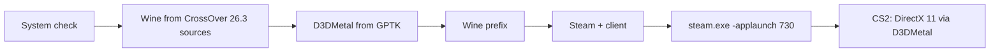

# CS2 Launcher

**English** | [Русский](README.md)

CS2 Launcher is a macOS (SwiftUI) app that runs the Windows build of Counter-Strike 2 on Apple Silicon Macs. It downloads a free Wine built from the CrossOver 26.3 sources, connects D3DMetal from Apple's Game Porting Toolkit, creates a prefix, installs the Windows Steam client and starts CS2 with `steam.exe -applaunch 730` (DirectX 11 through D3DMetal). A paid CrossOver is not required.

> The app's interface is currently in Russian only.

> **Status:** CS2 was tested on a MacBook Air M2 / macOS 26: the game reaches a map, the 4:3 image is stretched over the whole screen and VSync is on. A from-scratch setup was verified up to the Steam sign-in window.

## Requirements

- Apple Silicon Mac, macOS 15 or newer
- Internet: about 80 MB for the engine, ~2 MB for Steam and ~240 MB for the Steam client
- An Apple ID to download Game Porting Toolkit (free)
- Disk space: CS2 itself takes about 69 GB, ~80 GB recommended. Below 45 GB the launcher only warns

## Installation

1. Download the zip from Releases and unpack it.
2. Move `CS2 Launcher.app` to Applications.
3. The app is ad-hoc signed (no developer certificate), so on first launch right-click → Open, or run:

   ```sh
   xattr -dr com.apple.quarantine "/Applications/CS2 Launcher.app"
   ```

## Usage

1. Download **Game Porting Toolkit** (`Game_Porting_Toolkit_*.dmg`) from Apple: the "D3DMetal" step has an "Open the Apple page" button. It needs an Apple ID sign-in, under Downloads. Apple's license forbids redistributing D3DMetal, so the launcher takes it from your file. If the dmg is in Downloads it is found automatically, otherwise press "Choose .dmg".
2. On the setup screen press **"Install everything"**. In order, the launcher checks the system, installs Rosetta 2 (if missing), downloads the Wine engine and verifies its checksum, takes D3DMetal from the dmg, creates the prefix, installs Steam, downloads the Steam client once (about 3 minutes) and opens the sign-in window. Finished steps are skipped; after an error the button resumes where it stopped.
3. Sign in to Steam yourself and install Counter-Strike 2. The launcher never asks for or stores your login or password.
4. The launcher watches the download (`appmanifest_730.acf`) and moves to the main screen by itself.
5. Press "Play". "Stop" ends all Wine processes.

Rosetta 2 is installed with `softwareupdate --install-rosetta --agree-to-license`. If administrator rights are needed and it fails, the launcher shows the Terminal command with a copy button.

## 4:3 stretched over the whole screen

By default the game starts with `-novid -windowed -noborder -w 1024 -h 768`, and the launcher writes a 4:3 resolution without preserved aspect ratio to `cs2_video.txt`. The image is stretched over the full screen, since MacBook displays have no real 4:3 modes. Size and arguments can be changed in the settings. The "Apply recommended graphics" button sets light settings (MSAA off, CMAA, FSR, medium shadows and textures, VSync); they are written automatically only on the first launch. CS2 rewrites `cs2_video.txt` at startup, so the launcher also passes the size as arguments.

## Settings

The app's settings window (⌘,):

| Option | What it does |
|---|---|
| Engine | "Free engine" by default, or CrossOver if you already have it. Window size and "Native 16:10 resolution" are in the "Graphics" block |
| Game arguments | Passed to CS2 after `-applaunch 730` |
| Steam arguments | Extra `steam.exe` arguments |
| FPS cap | Adds `+fps_max N`; empty means no cap |
| Metal HUD | `MTL_HUD_ENABLED=1`, shows FPS and GPU load |
| Background apps to E-cores | While the game runs, Chrome, Discord, Telegram and others get background priority (on by default) |
| Performance mode | Disables the Steam overlay for CS2 and the launcher's background checks during play (on by default) |

## Performance

- **Memory.** CS2 takes about 3 GB and up to 300% CPU. On an 8 GB Mac close Chrome, Discord and Telegram: with swap above 3 GB the main screen shows a warning and the most memory-hungry apps. Nothing is closed automatically.
- **Load distribution.** While the game runs, the launcher applies `taskpolicy -b` to popular browsers and messengers so macOS moves them to efficiency cores. The priority is restored afterwards.
- **The Steam overlay** can use more than half a core under Wine, so performance mode disables it for CS2 (`OverlayAppEnable = "0"` in `localconfig.vdf`, only while Steam is closed; the original is backed up).
- **The first 1–3 matches** may stutter while D3DMetal builds its shader cache.
- **Steam without GPU.** The Steam window runs through a `steamwebhelper` wrapper with `--disable-gpu --single-process`, and Steam starts with `-noverifyfiles -norepairfiles -nobootstrapupdate -skipinitialbootstrap` so the original web helper does not come back.

## How it works



Data lives in `~/Library/Application Support/CS2Launcher`: `Engine/wine`, `Engine/d3dmetal`, `Engine/prefix`, `Logs`, `Downloads`, `settings.json`. The engine is downloaded from this repository's `wine-4` release, built in GitHub Actions; the launcher verifies the archive's sha256. The engine contract is described in [docs/engine.md](docs/engine.md).

## Troubleshooting

- **No Steam window.** On first setup the Steam client downloads for about 3 minutes. If no window appears, press "Stop" and start Steam again.
- **"Failed to create DirectX 11 render device".** D3DMetal is not connected: repeat the "D3DMetal" step and choose the dmg.
- **Logs.** The log is in the app ("Журнал") and written to `Logs`.
- **Game lags.** Close heavy apps, press "Apply recommended graphics", turn on Metal HUD and check the FPS.

## Known limitations

- VAC and matchmaking under Wine are not guaranteed. Use at your own risk.
- Performance depends on the M-series chip and memory size.
- The app is not signed with a developer certificate.

## Building from source

```sh
swift build
swift test
scripts/make-app.sh          # build/CS2 Launcher.app
scripts/package-release.sh   # zip + sha256 in build/
```

## Credits

- [CodeWeavers](https://www.codeweavers.com/) — the open-source CrossOver (Wine) code
- Apple Game Porting Toolkit (D3DMetal) — DirectX on top of Metal

## Disclaimer

The project is not affiliated with Valve, Apple or CodeWeavers. Counter-Strike and Steam are trademarks of Valve Corporation. License: [MIT](LICENSE).
