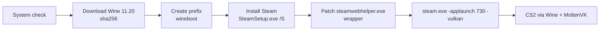

# CS2 Launcher

**English** | [Русский](README.md)

CS2 Launcher is a macOS (SwiftUI) app that lets Apple Silicon Macs run the Windows version of Counter-Strike 2. It downloads a pinned Wine build (Gcenx `wine-devel 11.20` with MoltenVK, sha256-verified; not bundled, fetched during setup), creates a Wine prefix, silently installs the Windows Steam client, patches `steamwebhelper.exe` (so Steam windows are not black) and launches CS2 via `steam.exe -applaunch 730` with `-vulkan`.

> The app's UI is currently Russian only.

> **Status:** installing Wine, the prefix and Steam, signing in to Steam and downloading CS2 are verified on an M2 / macOS 26. CS2 starts with `-vulkan` and reaches the main menu inside the engine, but the picture freezes on the splash screen: MoltenVK lacks a feature CS2's Vulkan renderer needs (`Metal does not allow uncompressed views of compressed images`). A different graphics backend is being investigated.

## Requirements

- Apple Silicon Mac
- macOS 15 or later
- Rosetta 2 (`softwareupdate --install-rosetta`)
- Free disk space: CS2 itself is about 69 GB, ~80 GB recommended (the built-in check only requires 45 GB at setup time, which is not enough for the game)

## Install

1. Download the zip from Releases and unzip it.
2. Move `CS2 Launcher.app` to Applications.
3. The app is ad-hoc signed (no developer certificate), so on first launch right-click → Open, or run:

   ```sh
   xattr -dr com.apple.quarantine "/Applications/CS2 Launcher.app"
   ```

## Usage

1. On the "Настройка" (Setup) screen press **"Установить всё"** (Install everything). The launcher runs the system check, installs Wine, creates (or updates) the prefix, installs Steam and then opens Steam, skipping steps that are already done. It shows "Шаг N из M" (step N of M). Nothing is downloaded before that click (~250 MB in total). On failure the button becomes "Повторить" (Retry) and resumes from the failed step. Individual steps can also be run by hand.
2. In Steam, sign in yourself and install Counter-Strike 2. The launcher never asks for or stores your credentials.
3. The launcher watches the download itself (`appmanifest_730.acf`): the CS2 step shows "Скачивается: NN%", is marked done automatically when finished, and the app switches to the main screen.
4. Press "Играть" (Play). It works whether Steam is already open or not (it passes `-applaunch 730`). The window appears after 20-60 seconds. "Стоп" (Stop) kills all Wine processes.

## Settings

App settings window (⌘,):

| Option | Effect |
|---|---|
| Game arguments | Passed to CS2 (default `-novid`). `-vulkan` is added automatically; use `-dx11` to override |
| Steam arguments | Extra `steam.exe` arguments |
| FPS cap | Adds `+fps_max N`; empty means unlimited |
| Metal HUD | `MTL_HUD_ENABLED=1`, shows FPS and GPU load |
| Retina mode | Wine Mac driver `RetinaMode`: native-resolution rendering, heavier |
| MSync | `WINEMSYNC=1`, `WINEESYNC=1` (on by default) |
| Advertise AVX | `ROSETTA_ADVERTISE_AVX=1` (on by default), needed to run under Rosetta 2 |

## How it works



Data lives in `~/Library/Application Support/CS2Launcher` (`Runtime`, `Prefix`, `Logs`, `Downloads`, `settings.json`).

The patch: `steamwebhelper.exe` is renamed to `steamwebhelper_real.exe` and replaced with a tiny wrapper ([wrapper/steamwebhelper-wrapper.c](wrapper/steamwebhelper-wrapper.c)) that starts the original with `--disable-gpu --single-process`. Steam is started with `-noverifyfiles -norepairfiles -nobootstrapupdate -skipinitialbootstrap` so it does not restore the original file. These flags are always added.

## Troubleshooting

- **Black Steam window.** Stop the processes ("Стоп") and start Steam or the game from the launcher again: the wrapper is re-applied on every launch if it was replaced.
- **Updating Steam.** Because of the flags, the Steam client does not update itself, and the flags cannot be turned off in settings. There is no reinstall button. The Steam step counts as done while `steam.exe` exists in the prefix; if you delete `drive_c/Program Files (x86)/Steam` inside `Prefix` (this also deletes the installed CS2), the step becomes available again and installs a fresh client.
- **Logs.** The log is shown in the app ("Журнал") and also written to a file in `Logs`.
- **Game does not start.** Try `-dx11` in game arguments, or disable "Advertise AVX" or MSync.

## Known limitations

- VAC and matchmaking under Wine are not guaranteed. Use at your own risk.
- Performance depends on your M-series chip.
- The CS2 renderer under MoltenVK is experimental.

## Building from source

```sh
swift build
swift test
scripts/make-app.sh          # build/CS2 Launcher.app
scripts/package-release.sh   # zip + sha256 in build/
scripts/build-wrapper.sh     # rebuild the wrapper, needs llvm-mingw (LLVM_MINGW env var)
```

## Credits

- [Gcenx/macOS_Wine_builds](https://github.com/Gcenx/macOS_Wine_builds) - Wine builds for macOS
- [MoltenVK](https://github.com/KhronosGroup/MoltenVK) - Vulkan on top of Metal
- The steamwebhelper wrapper idea comes from [notpop/steam-on-m1-wine](https://github.com/notpop/steam-on-m1-wine)

## Disclaimer

Not affiliated with Valve or Apple. Counter-Strike and Steam are trademarks of Valve Corporation. License: [MIT](LICENSE).
