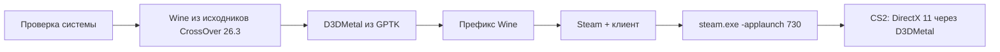

# CS2 Launcher

[English](README.en.md) | **Русский**

CS2 Launcher — приложение для macOS (SwiftUI), которое запускает Windows-версию Counter-Strike 2 на Маках с Apple Silicon. Оно само скачивает бесплатный Wine, собранный из исходников CrossOver 26.3, подключает D3DMetal из Apple Game Porting Toolkit, создаёт префикс, ставит Windows-клиент Steam и запускает CS2 через `steam.exe -applaunch 730` (DirectX 11 через D3DMetal). Платный CrossOver не нужен.

> Интерфейс приложения сейчас только на русском языке.

> **Статус:** CS2 проверена на MacBook Air M2 / macOS 26: игра доходит до карты, картинка 4:3 растянута на весь экран, VSync включён. Установка с нуля проверена до окна входа в Steam.

## Требования

- Mac с Apple Silicon и macOS 15 или новее
- Интернет: около 80 МБ для движка, ~2 МБ для Steam и ~240 МБ для клиента Steam
- Apple ID, чтобы скачать Game Porting Toolkit (бесплатно)
- Свободное место: сама CS2 занимает около 69 ГБ, рекомендуется ~80 ГБ. Если меньше 45 ГБ, лаунчер только предупреждает

## Установка

1. Скачайте zip из раздела Releases и распакуйте.
2. Перенесите `CS2 Launcher.app` в «Программы».
3. Приложение подписано ad-hoc (без сертификата разработчика), поэтому при первом запуске нажмите правой кнопкой → «Открыть», либо выполните:

   ```sh
   xattr -dr com.apple.quarantine "/Applications/CS2 Launcher.app"
   ```

## Использование

1. Скачайте **Game Porting Toolkit** (`Game_Porting_Toolkit_*.dmg`) со страницы Apple: в приложении на шаге «D3DMetal» есть кнопка «Открыть страницу Apple». Нужен вход с Apple ID, в разделе «Загрузки». Лицензия Apple запрещает распространять D3DMetal, поэтому лаунчер берёт его из вашего файла. Если dmg лежит в «Загрузках», он найдётся сам, иначе нажмите «Выбрать .dmg».
2. На экране «Настройка» нажмите **«Установить всё»**. Лаунчер по порядку: проверит систему, установит Rosetta 2 (если нет), скачает движок Wine и проверит его контрольную сумму, возьмёт D3DMetal из dmg, создаст префикс, поставит Steam, один раз загрузит клиент Steam (около 3 минут) и откроет окно входа. Уже выполненные шаги пропускаются, при ошибке кнопка продолжает с места остановки.
3. В окне Steam сами войдите в аккаунт и установите Counter-Strike 2. Логин и пароль лаунчер не запрашивает и не хранит.
4. Лаунчер следит за загрузкой (`appmanifest_730.acf`) и сам переходит на главный экран.
5. Нажмите «Играть». «Стоп» завершает все процессы Wine.

Rosetta 2 ставится командой `softwareupdate --install-rosetta --agree-to-license`. Если нужны права администратора и установка не прошла, лаунчер покажет команду для Терминала с кнопкой копирования.

## Картинка 4:3 на весь экран

По умолчанию игра запускается с `-novid -windowed -noborder -w 1024 -h 768`, а лаунчер записывает в `cs2_video.txt` разрешение 4:3 без сохранения пропорций. Изображение растягивается на весь экран, у MacBook нет настоящих режимов 4:3. Размер и параметры меняются в настройках. Кнопка «Применить рекомендуемую графику» ставит лёгкие настройки (MSAA выключено, CMAA, FSR, тени и текстуры на среднем уровне, VSync); автоматически они записываются только при первом запуске. CS2 перезаписывает `cs2_video.txt` при старте, поэтому лаунчер задаёт размер ещё и аргументами.

## Настройки

Окно настроек приложения (⌘,):

| Параметр | Что делает |
|---|---|
| Движок | «Бесплатный движок» по умолчанию или CrossOver, если он у вас уже установлен. Размер окна и «Родное разрешение 16:10» настраиваются в блоке «Графика» |
| Аргументы игры | Передаются CS2 после `-applaunch 730` |
| Аргументы Steam | Дополнительные аргументы `steam.exe` |
| Ограничение FPS | Добавляет `+fps_max N`; пусто — без ограничения |
| Metal HUD | `MTL_HUD_ENABLED=1`, показывает FPS и нагрузку GPU |
| Фоновые приложения — на E-ядра | Пока идёт игра, Chrome, Discord, Telegram и др. получают фоновый приоритет (по умолчанию включено) |
| Режим производительности | Отключает оверлей Steam для CS2 и фоновые проверки лаунчера во время игры (по умолчанию включён) |

## Производительность

- **Память.** CS2 занимает около 3 ГБ и до 300% CPU. На Mac с 8 ГБ закройте Chrome, Discord и Telegram: при свопе больше 3 ГБ на главном экране появляется предупреждение и список самых прожорливых приложений. Ничего не закрывается автоматически.
- **Распределение нагрузки.** Пока идёт игра, лаунчер выполняет `taskpolicy -b` для процессов популярных браузеров и мессенджеров, и macOS переносит их на энергоэффективные ядра. После игры приоритет возвращается.
- **Оверлей Steam** под Wine может занимать более половины ядра CPU, поэтому режим производительности отключает его для CS2 (`OverlayAppEnable = "0"` в `localconfig.vdf`, только когда Steam закрыт; оригинал сохраняется).
- **Первые 1–3 матча** возможны фризы: D3DMetal собирает кэш шейдеров.
- **Steam без GPU.** Окно Steam работает через обёртку `steamwebhelper` с `--disable-gpu --single-process`, а Steam запускается с `-noverifyfiles -norepairfiles -nobootstrapupdate -skipinitialbootstrap`, чтобы не вернуть оригинальный веб-помощник.

## Как это работает



Данные лежат в `~/Library/Application Support/CS2Launcher`: `Engine/wine`, `Engine/d3dmetal`, `Engine/prefix`, `Logs`, `Downloads`, `settings.json`. Движок скачивается из релиза `wine-4` этого репозитория, сборка выполняется в GitHub Actions; лаунчер сверяет sha256 архива. Подробности контракта движка — в [docs/engine.md](docs/engine.md).

## Если что-то не работает

- **Нет окна Steam.** При первой настройке клиент Steam загружается около 3 минут. Если окно не появилось, нажмите «Стоп» и запустите Steam снова.
- **«Failed to create DirectX 11 render device».** D3DMetal не подключён: повторите шаг «D3DMetal» и выберите dmg.
- **Логи.** Журнал доступен в приложении («Журнал») и пишется в `Logs`.
- **Игра лагает.** Закройте тяжёлые приложения, нажмите «Применить рекомендуемую графику», включите Metal HUD и проверьте FPS.

## Известные ограничения

- Работа VAC и матчмейкинга под Wine не гарантируется. Используйте на свой страх и риск.
- Производительность зависит от чипа M-серии и объёма памяти.
- Приложение не подписано сертификатом разработчика.

## Сборка из исходников

```sh
swift build
swift test
scripts/make-app.sh          # build/CS2 Launcher.app
scripts/package-release.sh   # zip + sha256 в build/
```

## Благодарности

- [CodeWeavers](https://www.codeweavers.com/) — открытые исходники CrossOver (Wine)
- Apple Game Porting Toolkit (D3DMetal) — DirectX поверх Metal

## Отказ от ответственности

Проект не связан с Valve, Apple или CodeWeavers. Counter-Strike и Steam — товарные знаки Valve Corporation. Лицензия: [MIT](LICENSE).
