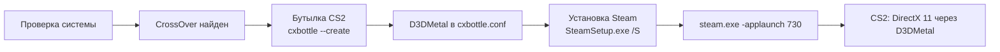

# CS2 Launcher

[English](README.en.md) | **Русский**

CS2 Launcher — приложение для macOS (SwiftUI), которое помогает запустить Windows-версию Counter-Strike 2 на Маках с Apple Silicon. Оно работает поверх [CrossOver](https://www.codeweavers.com/crossover): создаёт бутылку CrossOver, включает в ней D3DMetal, тихо устанавливает Windows-клиент Steam и запускает CS2 через `steam.exe -applaunch 730` (DirectX 11 через D3DMetal).

> Интерфейс приложения сейчас только на русском языке.

> **Статус:** Steam и CS2 (до главного меню) проверены на M2 / macOS 26 с CrossOver 26.3.

## Требования

- Mac с Apple Silicon
- macOS 15 или новее
- Rosetta 2 (`softwareupdate --install-rosetta`)
- [CrossOver](https://www.codeweavers.com/crossover) от CodeWeavers: 14 дней бесплатно, затем нужна лицензия. Устанавливается вами в «Программы», лаунчер его не содержит и не скачивает
- Свободное место: сама CS2 занимает около 69 ГБ, рекомендуется ~80 ГБ (встроенная проверка требует минимум 45 ГБ на момент настройки, этого не хватит для установки игры)

## Установка

1. Скачайте zip из раздела Releases и распакуйте.
2. Перенесите `CS2 Launcher.app` в «Программы».
3. Приложение подписано ad-hoc (без сертификата разработчика), поэтому при первом запуске нажмите правой кнопкой → «Открыть», либо выполните:

   ```sh
   xattr -dr com.apple.quarantine "/Applications/CS2 Launcher.app"
   ```

## Использование

1. Установите CrossOver. Если его нет, на шаге «CrossOver» кнопка **«Скачать CrossOver»** откроет сайт CodeWeavers; после установки нажмите «Проверить снова».
2. На экране «Настройка» нажмите **«Установить всё»**. Лаунчер по порядку выполнит проверку системы, проверит CrossOver, создаст бутылку `CS2` с включённым D3DMetal и установит Steam, затем откроет Steam; уже выполненные шаги пропускаются. Если CrossOver не найден, установка остановится с понятным сообщением. При ошибке кнопка превращается в «Повторить» и продолжает с шага, на котором остановилось.
3. Первый запуск новой бутылки регистрирует DLL около 3 минут, и только потом появляется окно Steam. Это нормально.
4. В открывшемся Steam сами войдите в аккаунт и установите Counter-Strike 2. Логин и пароль лаунчер не запрашивает и не хранит.
5. Лаунчер сам отслеживает загрузку (`appmanifest_730.acf`): на шаге CS2 показывается «Скачивается: NN%», по завершении шаг отмечается выполненным автоматически, и приложение переходит на главный экран.
6. Нажмите «Играть». Это работает и когда Steam уже открыт, и когда нет (запускается `-applaunch 730`). «Стоп» завершает все процессы бутылки.

### Перенос из старой установки

Ранние версии лаунчера использовали отдельный Wine и префикс в `~/Library/Application Support/CS2Launcher/Prefix`. Если он есть, а в бутылке Steam ещё нет, на шаге «Steam» появится кнопка **«Перенести Steam и CS2 из старой установки»**. Она клонирует папку Steam в бутылку (`cp -Rc`, клон APFS, мгновенно и без дополнительного места) и возвращает оригинальный `steamwebhelper.exe`. Старая папка не изменяется и не удаляется. Автоматически перенос не запускается.

## Настройки

Окно настроек приложения (⌘,):

| Параметр | Что делает |
|---|---|
| Аргументы игры | Передаются CS2 после `-applaunch 730` (по умолчанию `-novid`) |
| Аргументы Steam | Дополнительные аргументы `steam.exe` |
| Ограничение FPS | Добавляет `+fps_max N`; пусто — без ограничения |
| Metal HUD | `MTL_HUD_ENABLED=1`, показывает FPS и нагрузку GPU. Значение записывается и в `cxbottle.conf`, поэтому работает и при запуске игры кнопкой PLAY внутри Steam |
| Режим производительности | Отключает оверлей Steam для CS2 и фоновые проверки лаунчера во время игры (по умолчанию включён) |

`CX_GRAPHICS_BACKEND=d3dmetal` и `WINEMSYNC=1` записываются в `cxbottle.conf` бутылки при её подготовке.

## Производительность

- **Режим производительности.** Оверлей Steam (`gameoverlayui64.exe`) под Wine может занимать более половины ядра CPU и вызывать подтормаживания. Перед запуском Steam лаунчер выставляет `OverlayAppEnable = "0"` для CS2 в `userdata/<id>/config/localconfig.vdf` (только когда Steam закрыт; оригинал сохраняется один раз как `localconfig.vdf.cs2l-backup`). Если выключить режим, значение возвращается, но только там, где его изменил лаунчер. Пока CS2 запущена, лаунчер проверяет состояние не чаще раза в 30 секунд.
- **Metal HUD** показывает FPS и нагрузку GPU. Его можно включить в настройках, изменение применяется, когда Steam закрыт.
- **Первые 1–3 матча** возможны подтормаживания: D3DMetal собирает кэш шейдеров. Дальше игра идёт плавнее.
- **Рекомендуемые настройки в игре:** режим «Полноэкранный (в окне)» с разрешением 1280×832 или родным 16:10, MSAA выключено, включён FSR. Растянутое 4:3 на встроенных экранах MacBook невозможно: в них нет режимов 4:3.

## Как это работает



Бутылка лежит в `~/Library/Application Support/CrossOver/Bottles/CS2` и видна в самом CrossOver. Данные лаунчера — в `~/Library/Application Support/CS2Launcher` (`Logs`, `Downloads`, `settings.json`). Оригинальный `steamwebhelper.exe` не подменяется, Steam запускается без специальных флагов.

## Если что-то не работает

- **Нет окна Steam при первом запуске.** Подождите около 3 минут: CrossOver регистрирует DLL в новой бутылке.
- **CrossOver не найден.** Лаунчер ищет `/Applications/CrossOver.app` и `~/Applications/CrossOver.app`.
- **Логи.** Журнал доступен в приложении («Журнал»), также пишется в файл в `Logs`.
- **Игра не запускается.** Нажмите «Стоп» и запустите снова; проверьте в журнале, что бутылка `CS2` существует и D3DMetal включён.

## Известные ограничения

- Работа VAC и матчмейкинга под Wine не гарантируется. Используйте на свой страх и риск.
- Производительность зависит от чипа M-серии.
- После окончания пробного периода CrossOver нужна лицензия.

## Сборка из исходников

```sh
swift build
swift test                   # CrossOver для тестов не нужен
scripts/make-app.sh          # build/CS2 Launcher.app
scripts/package-release.sh   # zip + sha256 в build/
```

## Благодарности

- [CodeWeavers CrossOver](https://www.codeweavers.com/crossover) — слой совместимости Windows
- Apple D3DMetal (Game Porting Toolkit) — DirectX поверх Metal

## Отказ от ответственности

Проект не связан с Valve, Apple или CodeWeavers. Counter-Strike и Steam — товарные знаки Valve Corporation. CrossOver — товарный знак CodeWeavers. Лицензия: [MIT](LICENSE).
