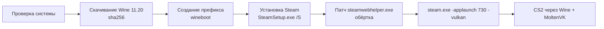

# CS2 Launcher

[English](README.en.md) | **Русский**

CS2 Launcher — приложение для macOS (SwiftUI), которое позволяет запустить Windows-версию Counter-Strike 2 на Маках с Apple Silicon. Оно скачивает закреплённую сборку Wine (Gcenx `wine-devel 11.20` с MoltenVK, проверка sha256; не входит в приложение, загружается при настройке), создаёт Wine-префикс, тихо устанавливает Windows-клиент Steam, патчит `steamwebhelper.exe` (чтобы окна Steam не были чёрными) и запускает CS2 через `steam.exe -applaunch 730` с `-vulkan`.

> Интерфейс приложения сейчас только на русском языке.

> **Статус:** установка Wine, префикса и Steam, вход в Steam и загрузка CS2 проверены на M2 / macOS 26. Запуск самой CS2 через MoltenVK ещё не проверен.

## Требования

- Mac с Apple Silicon
- macOS 15 или новее
- Rosetta 2 (`softwareupdate --install-rosetta`)
- Свободное место: сама CS2 занимает около 69 ГБ, рекомендуется ~80 ГБ (встроенная проверка требует минимум 45 ГБ на момент настройки, этого не хватит для установки игры)

## Установка

1. Скачайте zip из раздела Releases и распакуйте.
2. Перенесите `CS2 Launcher.app` в «Программы».
3. Приложение подписано ad-hoc (без сертификата разработчика), поэтому при первом запуске нажмите правой кнопкой → «Открыть», либо выполните:

   ```sh
   xattr -dr com.apple.quarantine "/Applications/CS2 Launcher.app"
   ```

## Использование

1. На экране «Настройка» нажмите **«Установить всё»**. Лаунчер по порядку выполнит проверку системы, установку Wine, создание (или обновление) префикса и установку Steam, затем откроет Steam; уже выполненные шаги пропускаются. Показывается «Шаг N из M». Загрузки идут только после этого нажатия (~250 МБ). При ошибке кнопка превращается в «Повторить» и продолжает с шага, на котором остановилось. Отдельные шаги можно выполнять и вручную.
2. В открывшемся Steam сами войдите в аккаунт и установите Counter-Strike 2. Логин и пароль лаунчер не запрашивает и не хранит.
3. Лаунчер сам отслеживает загрузку (`appmanifest_730.acf`): на шаге CS2 показывается «Скачивается: NN%», по завершении шаг отмечается выполненным автоматически, и приложение переходит на главный экран.
4. Нажмите «Играть». Это работает и когда Steam уже открыт, и когда нет (запускается `-applaunch 730`). Окно появляется через 20–60 секунд. «Стоп» завершает все процессы Wine.

## Настройки

Окно настроек приложения (⌘,):

| Параметр | Что делает |
|---|---|
| Аргументы игры | Передаются CS2 (по умолчанию `-novid`). `-vulkan` добавляется автоматически; чтобы использовать DirectX 11, укажите `-dx11` |
| Аргументы Steam | Дополнительные аргументы `steam.exe` |
| Ограничение FPS | Добавляет `+fps_max N`; пусто — без ограничения |
| Metal HUD | `MTL_HUD_ENABLED=1`, показывает FPS и нагрузку GPU |
| Retina-режим | Ключ `RetinaMode` драйвера Wine: рендер в полном разрешении, тяжелее |
| MSync | `WINEMSYNC=1`, `WINEESYNC=1` (включено по умолчанию) |
| Сообщать поддержку AVX | `ROSETTA_ADVERTISE_AVX=1` (включено по умолчанию), нужно для запуска под Rosetta 2 |

## Как это работает



Данные хранятся в `~/Library/Application Support/CS2Launcher` (`Runtime`, `Prefix`, `Logs`, `Downloads`, `settings.json`).

Патч: `steamwebhelper.exe` переименовывается в `steamwebhelper_real.exe`, а на его место кладётся маленькая обёртка ([wrapper/steamwebhelper-wrapper.c](wrapper/steamwebhelper-wrapper.c)), которая запускает оригинал с `--disable-gpu --single-process`. Steam запускается с флагами `-noverifyfiles -norepairfiles -nobootstrapupdate -skipinitialbootstrap`, чтобы он не восстановил оригинальный файл. Эти флаги добавляются всегда.

## Если что-то не работает

- **Чёрное окно Steam.** Остановите процессы («Стоп») и снова запустите Steam или игру из лаунчера: при каждом запуске обёртка применяется заново, если она была заменена.
- **Обновление Steam.** Из-за флагов клиент Steam не обновляет сам себя, и отключить эти флаги в настройках нельзя. Кнопки переустановки в приложении нет. Шаг «Steam» считается выполненным, пока существует `steam.exe` в префиксе; если удалить папку `drive_c/Program Files (x86)/Steam` внутри `Prefix` (вместе с ней удалится и установленная CS2), шаг снова станет доступен и поставит свежий клиент.
- **Логи.** Журнал доступен в приложении («Журнал»), также пишется в файл в `Logs`.
- **Не запускается игра.** Попробуйте `-dx11` в аргументах игры, отключите «Сообщать поддержку AVX» или MSync.

## Известные ограничения

- Работа VAC и матчмейкинга под Wine не гарантируется. Используйте на свой страх и риск.
- Производительность зависит от чипа M-серии.
- Рендерер CS2 через MoltenVK экспериментальный.

## Сборка из исходников

```sh
swift build
swift test
scripts/make-app.sh          # build/CS2 Launcher.app
scripts/package-release.sh   # zip + sha256 в build/
scripts/build-wrapper.sh     # пересобрать обёртку, нужен llvm-mingw (переменная LLVM_MINGW)
```

## Благодарности

- [Gcenx/macOS_Wine_builds](https://github.com/Gcenx/macOS_Wine_builds) — сборки Wine для macOS
- [MoltenVK](https://github.com/KhronosGroup/MoltenVK) — Vulkan поверх Metal
- Идея обёртки steamwebhelper — [notpop/steam-on-m1-wine](https://github.com/notpop/steam-on-m1-wine)

## Отказ от ответственности

Проект не связан с Valve или Apple. Counter-Strike и Steam — товарные знаки Valve Corporation. Лицензия: [MIT](LICENSE).
